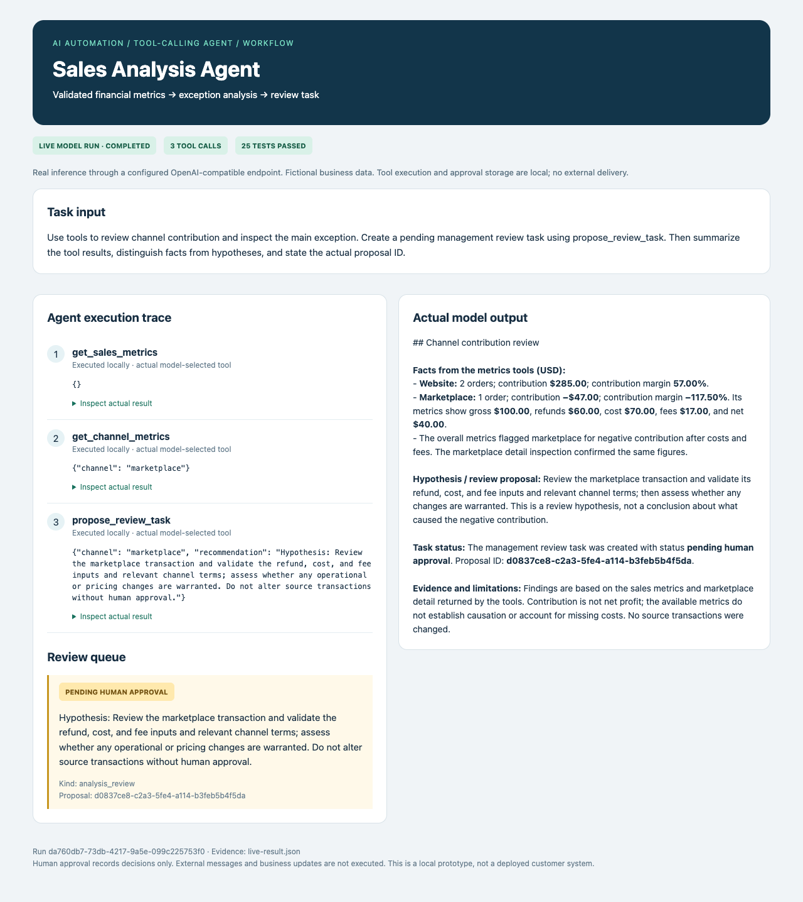

# Sales Analysis Agent

**Use validated financial metrics to explain channel exceptions and queue review tasks.**



**Python · Workflow automation · Tool-calling AI · Human review**

## Version 0.4 — Tool-calling AI workflow

This project now includes `agent.py`: an OpenAI-compatible Chat Completions client, a bounded multi-turn tool loop, domain tools backed by the existing application, a SQLite execution journal, and human review of proposed actions. The model chooses tools and receives their actual results. No arbitrary code execution or model-controlled network destinations are exposed.

## Run

Use Python 3.10+ from this repository directory. Configure `AI_BASE_URL`, `AI_MODEL`, and `AI_API_KEY` in your shell (see `.env.example`; use `--config /path/to/.env.local` to load a file without shell execution). Use a provider/model that supports Chat Completions function calling. Do not commit credentials.

```sh
python3 agent.py --config /path/to/.env.local --prompt "Review the available records and propose the next action" --output live-result.json
# Offline integration evidence, explicitly NOT a live model run:
python3 agent.py --fixture --output fixture-result.json
python3 agent.py --review PROPOSAL_ID --reviewer local-operator --decision approved
python3 -m unittest discover -s tests -v
```

The approval command records a local review decision only; it does not send messages or execute changes in external systems. Reviewer labels are not authenticated identities. This is a local portfolio prototype, not a deployed multi-user product. Each run is a separate analysis; duplicate actions within one run are deduplicated, but cross-run deduplication is not provided.

## Evidence and limitations

`fixture-result.json` contains real local tool executions with a **scripted model substitute**. It verifies orchestration and approval boundaries; it is not proof of model quality. Live inference was verified with a user-configured compatible service; see `live-result.json` and `agent-live.png`. Reproducing it requires your own credentials. Outputs from a model require review: schema validation and evidence references do not guarantee factual correctness. English urgent-keyword routing disables support drafts for listed terms, but is not a comprehensive emergency detector. The support demo is fixed to one demo property; do not use it for arbitrary customer properties.

Provider calls have a 60-second timeout, 6-turn/12-tool-call budget, and 1,800 output-token cap per call. Provider errors fail the run; there is no silent fallback to fixture mode. Local journals contain prompts and results—use fictional data for public evidence, do not publish customer data. No external delivery or production integration is claimed.

## Verified live evidence


[Open the run viewer](agent-live.html). The viewer formats actual JSON execution records; it is not a production staff dashboard. The configured model identifier is supplied by the provider, not independently attested. Human review is a local decision record, not an external action executor.

## Original workflow (v0.3; its no-LLM limitation applies to the legacy interface only)

# Sales Economics — Revenue, Refunds and Channel Contribution

**Business question:** Which sales channels generate contribution after refunds, product cost and fees?

Version 0.3 moves beyond sales totals to order-level reconciliation and channel economics. It validates sale/refund relationships, supports multiple partial refunds, calculates true order-count AOV for the stated input contract, and flags negative contribution channels.

## Run the business report

Python 3.10+, standard library only. From this repository root:

```sh
python3 business.py examples/orders.csv --output output/channel-report.html
python3 -m unittest discover -s tests -v
```

Open `output/channel-report.html` offline. Input columns are `event_id,order_id,date,kind,amount,cost,fee,channel,currency`. Exactly one sale row per order; refund rows reference the original order and use nonnegative amounts. Include the original sale even when analyzing a later refund. Same currency per file, same channel per order/refund, refunds cannot precede the sale or exceed its value. Invalid data blocks report generation and preserves any previous report.

[Download the generated offline HTML example](examples/channel-report.html)

## What the fictional sample demonstrates

| Metric | Sample value (USD) |
|---|---:|
| Gross sales | 600.00 |
| Refunds | 60.00 |
| Net sales | 540.00 |
| Recorded product costs | 270.00 |
| Recorded fees | 32.00 |
| Contribution | 238.00 |
| Website contribution | 285.00 |
| Marketplace contribution | -47.00 |
| Gross average order value | 200.00 |

The marketplace has positive sales but negative contribution in this sample. That is an actionable review signal: examine costs, refund policy and channel fees before scaling that channel. This is synthetic illustration, not an actual customer's result or a causal recommendation.

## Accounting definitions and limits

Contribution = net sales − entered product costs − entered fees. It is **not net profit**: overhead, advertising spend, wages, tax and other unrecorded costs are excluded. Refund costs are zero in the input contract; the original product cost is retained conservatively, with no assumed inventory recovery. Refund fees represent additional fees, not reversed fees. Chargebacks, inventory recovery, fee reversals and partial shipments require an expanded ledger model.

The report covers all supplied orders and events; it does not implement period filtering or accrual accounting. Daily charts use event dates; no timezone conversion, FX or multi-currency consolidation. Order identifiers must be stable. No actual customer data is included. A useful implementation scope is one explicitly mapped export format plus agreed definitions, reconciliation examples, and report handover; live connectors and scheduled delivery are separate work.

## Verify

Tests cover orphan/excess/early refunds, channel mismatches, partial refunds, duplicate events/orders, currency validation, escaping untrusted channel names, and negative-contribution signals.

## Previous interface transaction summary (still supported)

# Sales Report Automation

**Turn a transaction export into an inspectable business summary and standalone HTML chart.**

Python portfolio prototype that validates the entire dataset before publishing a report. Includes exact decimal totals, refunds, average positive sale, refund value rate, and daily net sales with zero-activity dates filled in.

## Quick start

Python 3.10+, no third-party dependencies. From the repository root:

```sh
python3 report.py examples/sales.csv --output output/report.html
python3 -m unittest discover -s tests -v
```

Open `output/report.html` in a browser. It works offline, contains no external scripts, and adapts to the viewport. Command output is a machine-readable JSON summary. The report path is written atomically only after validation succeeds; invalid data returns exit code 2 and leaves any existing report untouched.

## Input contract

CSV columns: `transaction_id,date,amount,currency`. IDs must be unique and non-empty. Dates must be ISO calendar dates. Amounts must be finite and exactly representable in cents. One three-letter currency code per file; no currency conversion. Date spans are limited to 3660 days. Currency codes are syntactically checked, not validated against an ISO registry.

## Sample results

| Metric | Fictional sample result |
|---|---:|
| Transactions | 4 |
| Gross sales | USD 500.00 |
| Refund value | USD 20.00 |
| Net sales | USD 480.00 |
| Average positive sale | USD 166.67 |
| Refund value / gross sales | 4.00% |

October 2 has no transactions and appears as zero on the chart. Red bars represent negative daily totals; bar width represents absolute magnitude. A positive transaction is treated as one sale; this is not order-level AOV when orders span multiple transactions. Refund value rate is not a customer/cohort return rate. All-negative inputs have no defined refund value rate.

## Evidence and production limits

[Tests](tests/test_report.py) cover duplicate IDs, invalid dates, mixed currencies, non-finite amounts, fractions of cents, refund-only data, zero-activity dates, and preservation of prior reports on failure.

No real client data is included. Timezones, scheduling, email delivery, accounting reconciliation, taxes, and FX conversion are outside scope. CSV input dates are assumed already normalized to the business reporting timezone. Large datasets and production access controls need separate evaluation.


### Transport configuration

HTTPS is required by default. For a self-hosted HTTP service, the operator can explicitly allow a single origin using `AI_ALLOW_HTTP_ORIGIN=http://host:port` in the local configuration file. Redirects are refused. Never upload that file or include provider credentials in screenshots.
